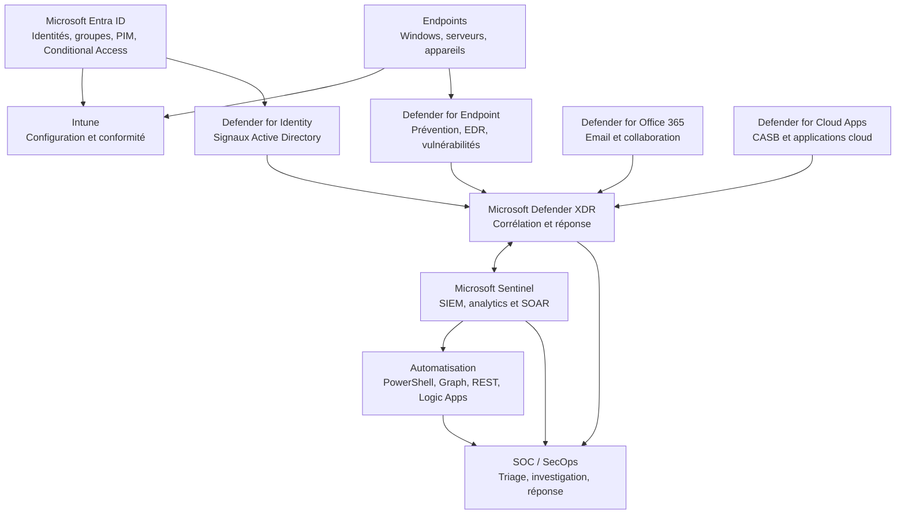

# KQL, automatisation, RBAC, architecture et RUN

> Document transverse de référence pour concevoir, sécuriser, industrialiser et exploiter les services Microsoft Security.

**Statut :** Socle méthodologique – à compléter par les procédures propres à chaque tenant  
**Périmètre :** Microsoft Defender XDR, Defender for Endpoint, Defender for Identity, Defender for Office 365, Defender for Cloud Apps, Microsoft Sentinel, Microsoft Entra ID et Intune  
**Dernière mise à jour :** 08/11/2026

---

## 1. Objectifs et principes

Ce document définit un cadre commun pour les activités KQL, automatisation, contrôle des accès, architecture et exploitation RUN.

Principes directeurs :

- **Zero Trust** : vérifier explicitement les identités, les appareils et le contexte d’accès.
- **Moindre privilège** : attribuer uniquement les permissions nécessaires, pour une durée et un périmètre maîtrisés.
- **Séparation des responsabilités** : distinguer administration, investigation, approbation et exécution des remédiations.
- **Traçabilité** : journaliser les opérations, changements, exécutions et décisions.
- **Automatisation contrôlée** : prévoir validation, gestion des erreurs, idempotence et mécanisme de retour arrière lorsque pertinent.
- **Sécurité dès la conception** : intégrer les exigences de sécurité et d’exploitation dès la phase d’architecture.

Les paramètres, rôles, licences, endpoints API et fonctionnalités doivent être vérifiés pour le tenant et la version concernés avant déploiement.

## 2. KQL – Détection, investigation et Threat Hunting

### 2.1 Positionnement

Kusto Query Language (KQL) permet d'interroger les données de télémétrie et de sécurité dans les environnements Microsoft qui exposent un moteur Kusto, notamment :

- **Microsoft Defender XDR – Advanced Hunting** : investigation et hunting sur les tables de données Defender disponibles dans le tenant.
- **Microsoft Sentinel – Logs** : investigation sur les tables ingérées dans le Log Analytics workspace, création de règles analytiques et analyse des incidents.
- **Workbooks** : visualisation et suivi de métriques à partir de requêtes adaptées à leur source.

Les schémas, tables, colonnes, périodes de rétention et droits d'accès diffèrent selon le produit, la licence, la configuration et les connecteurs activés. Ne pas transposer une requête d'un portail à l'autre sans vérifier le schéma.

### 2.2 Structure recommandée d'une requête

1. Définir la question de sécurité et le résultat attendu.
2. Identifier la source et la table réellement disponibles.
3. Définir une fenêtre temporelle explicite.
4. Filtrer tôt pour réduire le volume traité.
5. Sélectionner uniquement les colonnes nécessaires.
6. Enrichir ou corréler les événements si cela apporte une valeur démontrable.
7. Vérifier les faux positifs et les cas limites.
8. Documenter la logique, les limites et la fréquence d'exécution.

Exemple générique à adapter au schéma disponible :

```kusto
// Exemple pédagogique : activité récente sur une table à confirmer
<TableName>
| where TimeGenerated >= ago(24h)
| where <Condition>
| project TimeGenerated, <RelevantField1>, <RelevantField2>
| order by TimeGenerated desc
```

Cet exemple est un patron de rédaction, pas une requête directement exécutable : remplacer les éléments entre chevrons et vérifier les noms de colonnes dans la table cible.

### 2.3 Cas d'usage

| Cas d'usage | Objectif | Résultat attendu |
|---|---|---|
| Threat Hunting | Rechercher un comportement suspect ou une TTP | Éléments de preuve et hypothèse documentée |
| Investigation | Reconstituer une séquence d'événements | Chronologie et périmètre impacté |
| Détection | Identifier un comportement répondant à une logique définie | Règle testée et maîtrisée |
| Corrélation | Relier plusieurs événements ou entités | Contexte enrichi, sans surinterprétation |
| Reporting | Mesurer tendances, volumes et délais | Indicateurs reproductibles |

### 2.4 Qualité et cycle de vie des requêtes

- Versionner les requêtes et conserver leur objectif, auteur, date et environnement.
- Tester sur un jeu de données connu et comparer les résultats attendus.
- Mesurer le volume retourné, la durée d'exécution et le coût lorsque applicable.
- Documenter les exclusions et les limites de visibilité.
- Revoir périodiquement les requêtes devenues inutiles ou obsolètes.
- Pour une règle de détection, formaliser la sévérité, les entités, le regroupement, la fréquence, les exceptions et le propriétaire RUN.

## 3. Automatisation – PowerShell, Microsoft Graph, REST API et Logic Apps

### 3.1 Principes d'architecture

Une automatisation de sécurité doit comporter les éléments suivants :

1. **Déclencheur** : planification, événement, demande opérateur ou workflow.
2. **Identité d'exécution** : identité managée lorsque le service le permet ; sinon application Entra ID avec certificat ou mécanisme sécurisé adapté.
3. **Authentification** : méthode documentée, sans secret en clair ni identifiants intégrés au script.
4. **Autorisation** : permissions minimales, limitées aux ressources et opérations nécessaires.
5. **Traitement** : validation des entrées, logique métier et contrôle des préconditions.
6. **Journalisation** : identifiant d'exécution, horodatage, cible, résultat et erreurs sans données sensibles inutiles.
7. **Gestion des erreurs** : reprise maîtrisée, délais, limites de débit et traitement des réponses non réussies.
8. **Contrôle humain** : approbation préalable pour les actions à fort impact.
9. **Retour arrière** : procédure de restauration ou de correction lorsqu'elle est techniquement possible.

### 3.2 Choix du mécanisme

| Mécanisme | Usage adapté | Points de vigilance |
|---|---|---|
| PowerShell | Administration, collecte, contrôles et tâches récurrentes | Modules, versions, contexte d'authentification, gestion des erreurs |
| Microsoft Graph | Accès programmatique aux ressources Microsoft 365 et Entra prises en charge | Permissions déléguées/applicatives, consentement, pagination et limitations API |
| REST API | Intégration de services exposant une API documentée | Authentification, version, schéma, quotas et compatibilité |
| Logic Apps | Orchestration événementielle et intégration de services | Connecteurs, identité, coûts, reprise et gouvernance |
| Azure Automation | Exécution planifiée ou opérée de runbooks | Identité managée, modules, réseau, journalisation et contrôle des changements |

Le choix doit être fondé sur les exigences de sécurité, le volume, le déclencheur, les dépendances et les capacités réellement disponibles dans le tenant.

### 3.3 Contrôles obligatoires avant exécution

- Exécuter d'abord en lecture seule ou en mode simulation lorsque possible.
- Valider les paramètres et limiter explicitement le périmètre cible.
- Prévoir un mécanisme d'approbation pour les opérations sensibles.
- Éviter les droits globaux lorsque des permissions ciblées existent.
- Ne jamais écrire de mot de passe, secret, token ou clé privée dans le code, les logs ou le dépôt.
- Tester les erreurs d'authentification, d'autorisation, de quota et de connectivité.
- Contrôler les résultats après exécution et conserver une preuve d'exécution.

### 3.4 Exemple de squelette PowerShell non destructif

```powershell
[CmdletBinding()]
param(
    [Parameter(Mandatory)]
    [ValidateNotNullOrEmpty()]
    [string]$Target
)

$ErrorActionPreference = 'Stop'

try {
    Write-Information "Début du contrôle pour la cible : $Target" -InformationAction Continue

    # Ajouter ici une opération documentée en lecture seule.
    # Vérifier les prérequis et les permissions avant toute action d'écriture.

    Write-Information "Contrôle terminé." -InformationAction Continue
}
catch {
    Write-Error -Message ("Échec du traitement : {0}" -f $_.Exception.Message)
    throw
}
```

Ce squelette ne se connecte à aucun service et n'effectue aucune modification. Les commandes de connexion et d'action doivent être ajoutées après validation du module, de la version et des permissions requis.

## 4. RBAC – Gouvernance des accès et séparation des responsabilités

### 4.1 Objectifs

Le Role-Based Access Control (RBAC) organise l'accès aux fonctions et aux données selon les responsabilités opérationnelles. Il doit couvrir :

- qui peut consulter les données ;
- qui peut investiguer et gérer les incidents ;
- qui peut modifier les politiques et paramètres ;
- qui peut approuver ou exécuter une remédiation ;
- sur quel périmètre (tenant, groupe d'appareils, workspace, ressource ou service).

### 4.2 Modèle de conception

| Profil fonctionnel | Besoin typique | Contrôle recommandé |
|---|---|---|
| Lecteur / Auditeur | Consulter configuration, posture et preuves | Accès en lecture seule |
| Analyste SOC N1 | Triage et qualification initiale | Droits limités aux opérations de triage |
| Analyste SOC N2/N3 | Investigation approfondie et hunting | Accès aux données et fonctions nécessaires |
| Ingénieur plateforme | Configurer les composants techniques | Rôle d'administration limité au produit et au périmètre |
| Responsable sécurité | Gouvernance, validation et suivi | Droits adaptés à la responsabilité, sans privilège systématique |
| Compte d'automatisation | Exécuter un workflow précis | Identité dédiée et permissions minimales |

Ce tableau est un modèle fonctionnel, pas une correspondance directe avec les rôles intégrés Microsoft. Le mapping exact doit être établi à partir des rôles et permissions documentés pour chaque produit.

### 4.3 Règles de gouvernance

- Privilégier les groupes Entra ID pour attribuer et réviser les accès lorsque le produit le permet.
- Séparer les rôles de lecture, investigation, administration et remédiation.
- Définir les périmètres d'administration et les groupes d'appareils concernés.
- Utiliser PIM pour les rôles éligibles et les activations temporaires lorsque pris en charge.
- Mettre en place des Access Reviews selon la criticité et la fréquence définie.
- Contrôler les comptes d'urgence, comptes de service et identités applicatives.
- Tracer les attributions, activations, changements et opérations privilégiées.
- Réaliser des tests négatifs pour confirmer qu'un rôle ne peut pas dépasser son périmètre.

### 4.4 Matrice RBAC à maintenir

| Produit / ressource | Groupe Entra | Rôle produit | Portée | Type d'accès | Approbateur | Revue |
|---|---|---|---|---|---|---|
| Defender XDR | À définir | À valider | Tenant / périmètre | Lecture / investigation / administration | À définir | Périodique |
| Defender for Endpoint | À définir | À valider | Device groups | Lecture / remédiation / configuration | À définir | Périodique |
| Microsoft Sentinel | À définir | À valider | Subscription / workspace / resource group | Lecture / incident / règles / automation | À définir | Périodique |
| Microsoft Entra ID | À définir | À valider | Tenant / administrative unit si applicable | Lecture / administration / privilège | À définir | Périodique |
| Intune | À définir | À valider | Scope groups / scope tags | Lecture / configuration / assignation | À définir | Périodique |

Les rôles et portées exacts sont **À VALIDER** selon les fonctionnalités activées, le modèle RBAC du produit et les exigences du client.

## 5. Architecture – Principes de conception transverse

### 5.1 Vue logique



Schéma conceptuel : les intégrations, flux, connecteurs et capacités exactes doivent être confirmés pour le tenant. Il ne représente pas une topologie réseau exhaustive ni une obligation d'activer chaque composant.

### 5.2 Questions d'architecture à traiter

- Quelles sources produisent les signaux et quelles données sont réellement collectées ?
- Où sont stockées les données, avec quelle rétention et quels contrôles d'accès ?
- Quels flux réseau, endpoints, connecteurs et dépendances sont nécessaires ?
- Comment sont gérés les identités humaines, administratives et applicatives ?
- Comment sont séparés les environnements de production, test et pilote ?
- Comment les incidents et actions sont-ils corrélés entre Defender XDR et Sentinel ?
- Quelles actions sont automatiques, semi-automatiques ou soumises à approbation ?
- Comment garantir la résilience, la continuité de service et la traçabilité ?

## 6. RUN – Exploitation et maintien en condition de sécurité

### 6.1 Activités récurrentes

| Activité | Contrôle RUN | Preuve / indicateur |
|---|---|---|
| Santé des services | Vérifier connecteurs, capteurs, agents et ingestion | État de santé, erreurs et couverture |
| Alertes et incidents | Triage, qualification, priorisation et escalade | Incidents traités et délais |
| Détection | Contrôler qualité, bruit et efficacité des règles | Taux de faux positifs, couverture et tests |
| Vulnérabilités | Suivre recommandations et plans de remédiation | Risques ouverts, ancienneté et taux de correction |
| Accès | Revoir rôles, groupes et privilèges | Revues d'accès et écarts |
| Automatisations | Vérifier exécutions, échecs et dérives | Taux de succès, durée et erreurs |
| Changements | Valider, tester et tracer les modifications | Change record et résultat de recette |
| Reporting | Consolider les indicateurs et plans d'action | Tableau de bord périodique |

### 6.2 Processus de traitement d'un incident

1. **Détecter** : réception de l'alerte ou de l'incident.
2. **Qualifier** : vérifier la source, la sévérité, les entités et la fiabilité des éléments.
3. **Investiguer** : utiliser les données Defender XDR et/ou Sentinel disponibles.
4. **Évaluer l'impact** : déterminer les identités, appareils, applications et ressources concernés.
5. **Décider** : appliquer la matrice d'escalade et les règles d'approbation.
6. **Contenir et remédier** : exécuter les actions autorisées dans le périmètre approuvé.
7. **Vérifier** : confirmer l'efficacité de la remédiation et l'absence de récurrence immédiate.
8. **Clôturer** : documenter les preuves, la cause, les actions et les enseignements.

### 6.3 KPI recommandés

- Couverture des endpoints onboardés / endpoints attendus.
- Santé des capteurs et connecteurs.
- Délai moyen de qualification (MTTA).
- Délai moyen de réponse et de remédiation (MTTR).
- Volume d'incidents par sévérité et par périmètre.
- Taux de faux positifs et taux de réouverture.
- Âge des vulnérabilités critiques et taux de remédiation.
- Pourcentage de comptes privilégiés revus.
- Taux de succès des automatisations.
- Nombre d'exceptions actives et ancienneté des exceptions.

Définir pour chaque KPI une formule, une source, une fréquence, un propriétaire, une cible et un seuil d'alerte. Ne pas comparer des indicateurs dont les périmètres ou méthodes de calcul diffèrent.

## 7. Méthodologie de réalisation BUILD

| Étape | Travaux | Livrables |
|---|---|---|
| ANALYSER | Inventaire, besoins, flux, licences, rôles, risques et contraintes | Dossier d'existant et matrice d'écarts |
| CONCEVOIR | Architecture cible, modèle de données, RBAC, flux et exploitation | HLD / LLD, schémas et matrices |
| CHALLENGER | Vérification des hypothèses, limites, dépendances et scénarios de panne | ADR, registre des risques et décisions |
| INTÉGRER | Paramétrage, connecteurs, permissions et workflows | Configuration documentée |
| INDUSTRIALISER | Scripts, requêtes KQL, pipelines et contrôles | Dépôt versionné et procédures |
| EXPLOITER | Supervision, incidents, changements et support | Runbooks, RACI et KPI |
| AMÉLIORER | Analyse des résultats, audits et optimisation | Plan d'amélioration et roadmap |

## 8. Plan de tests et critères d'acceptation

| Domaine | Test positif | Test négatif | Critère d'acceptation |
|---|---|---|---|
| KQL | La requête retourne les événements attendus | Période ou filtre sans résultat | Résultats cohérents, documentés et reproductibles |
| Automatisation | Workflow exécuté avec succès | Identité non autorisée ou entrée invalide | Échec contrôlé, aucune action non autorisée |
| RBAC | Utilisateur autorisé réalise l'action prévue | Utilisateur hors périmètre tente la même action | Accès refusé et journalisé |
| Architecture | Flux et intégrations fonctionnent | Dépendance indisponible | Comportement dégradé connu et procédure d'escalade |
| RUN | Incident traité selon procédure | Alerte incomplète ou faux positif | Qualification, escalade et traçabilité conformes |

Toute action de remédiation à fort impact doit être testée en environnement contrôlé, avec validation humaine, critères d'arrêt et plan de retour arrière.

## 9. Transfert au RUN et gouvernance

Le transfert doit inclure :

- Dossier d'architecture HLD/LLD et schémas à jour.
- Inventaire des composants, flux, dépendances et propriétaires.
- Matrices RBAC, RACI et circuits d'approbation.
- Catalogue des requêtes KQL, règles de détection et automatisations.
- Procédures de supervision, incident, changement et escalade.
- Procédures de sauvegarde / restauration ou rollback lorsque pertinentes.
- KPI, seuils, fréquence de reporting et responsabilités.
- Formation des équipes et validation formelle de la prise en charge.

## 10. Références Microsoft Learn

Les références ci-dessous sont des points d'entrée officiels. Vérifier la documentation spécifique au produit et à la version au moment de l'implémentation.

- [Kusto Query Language (KQL) – documentation](https://learn.microsoft.com/en-us/kusto/query/)
- [Microsoft Sentinel – documentation](https://learn.microsoft.com/en-us/azure/sentinel/)
- [Microsoft Defender XDR – Advanced Hunting](https://learn.microsoft.com/en-us/defender-xdr/advanced-hunting-overview)
- [Microsoft Graph – documentation](https://learn.microsoft.com/en-us/graph/)
- [Microsoft Graph PowerShell SDK](https://learn.microsoft.com/en-us/powershell/microsoftgraph/)
- [Azure Logic Apps – documentation](https://learn.microsoft.com/en-us/azure/logic-apps/)
- [Azure Automation – documentation](https://learn.microsoft.com/en-us/azure/automation/)
- [Microsoft Entra ID – RBAC](https://learn.microsoft.com/en-us/entra/identity/role-based-access-control/)
- [Microsoft Entra Privileged Identity Management](https://learn.microsoft.com/en-us/entra/id-governance/privileged-identity-management/)
- [Microsoft Defender XDR – rôles et permissions](https://learn.microsoft.com/en-us/defender-xdr/manage-rbac)

---

## Historique des modifications

| Date | Modification |
|---|---|
| 08/11/2026 | Création du socle transverse KQL, automatisation, RBAC, architecture et RUN |
